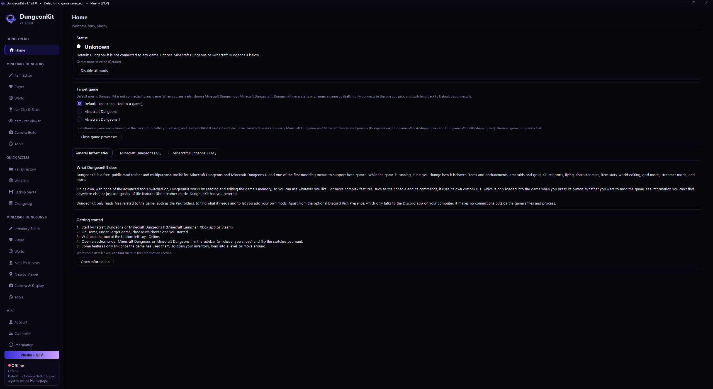
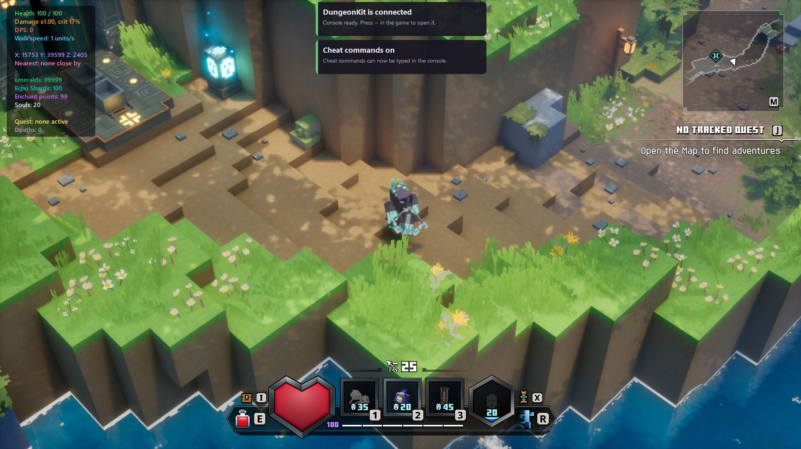
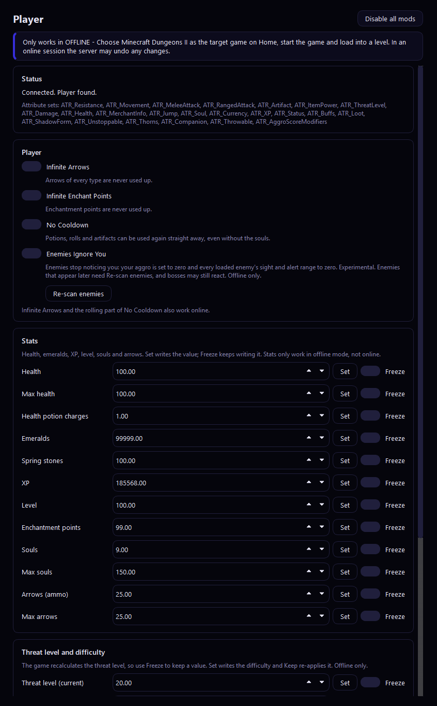
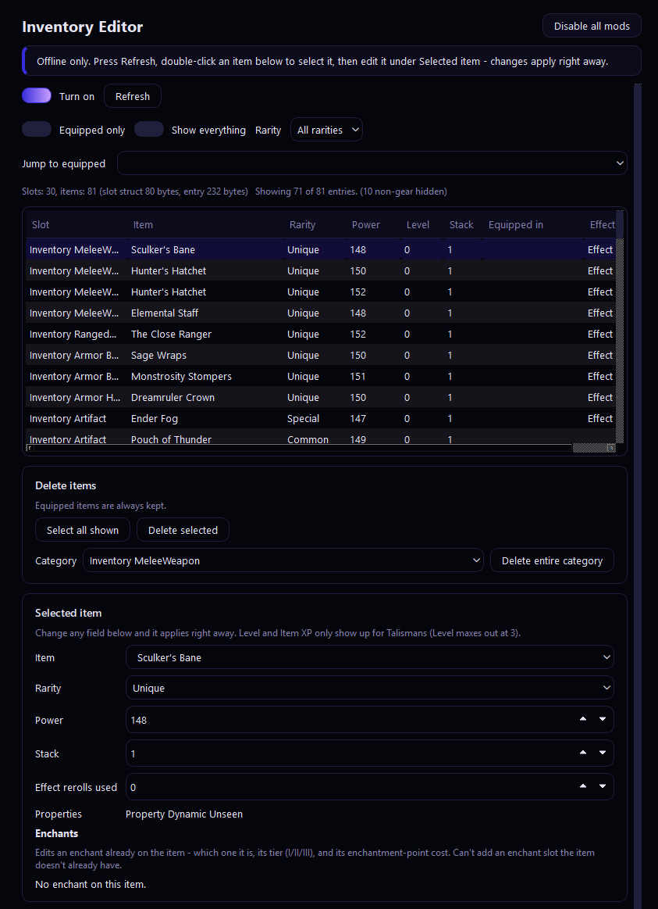
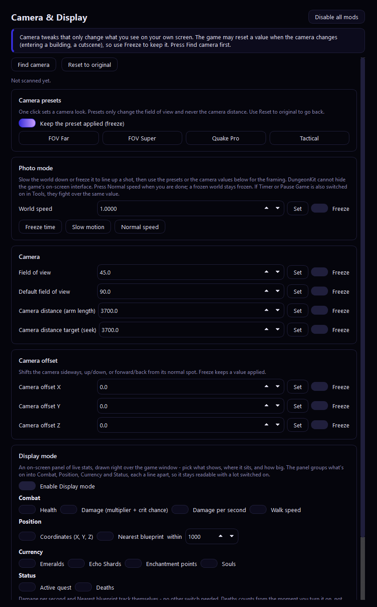

# DungeonKit


A free trainer / companion app for **Minecraft Dungeons** and **Minecraft Dungeons II**. It reads and edits the game's own memory live while you play, the same idea as a Cheat Engine table, just packaged into a proper GUI app. No Cheat Engine needed.

<p align="center"></p>

<p align="center">
  
  
</p>

## Supported games & platforms

| Game | Platforms | Online / Offline |
|---|---|---|
| Minecraft Dungeons | Steam, Xbox App / Microsoft Store, Minecraft Launcher | Works both online and offline |
| Minecraft Dungeons II | Microsoft Store / Xbox App, Steam | **Offline only** — online sessions let the server overwrite most changes, so pick Offline mode in-game before using DungeonKit |

DungeonKit auto-detects which game and build you're running. Most features work across all platforms; a few are marked **experimental** in-app where they depend on the exact build.

> **Disclaimer:** This is an editing/trainer tool for your own save data and game memory. Use it at your own risk — by using DungeonKit (including online with Minecraft Dungeons) you take full responsibility for anything that happens as a result, including to your account, saves, or game state. Back up your saves before editing. DungeonKit is not affiliated with Mojang, Microsoft, or Double Eleven.

## Features

**Minecraft Dungeons**
- Infinite Arrows, Infinite Lives, No Cooldown, Infinite Enchant Points
- Currency editing (Emeralds, Gold, Ender Eyes) and XP multiplier / total XP
- Threat/Apocalypse Level editing
- Position save/teleport, plus a Teleports page for every mission and area
- No Clip & Fly, God Mode, live Player Stats
- Full **Item Editor** — item ID, power, rarity, gilded status, enchants + tiers, stats, copy/load item
- Merchant price editing, Camera Editor with Photo Mode, console command access

**Minecraft Dungeons II**
- Player tools — God Mode, No Clip, Overkill control, No Cooldown, Infinite Arrows/Enchant Points, difficulty lock-in, enemies-ignore-you mode

  

- Inventory Viewer & Editor — edit power, rarity, level, stack, rerolls, gilded properties, plus an **Enchants editor** (which enchant, tier, point cost)

  

- World tools — jump to any mission/area, live quest tracking, waypoints
- Nearby Viewer — nearby chests/enemies with distance, auto-rescan
- Item rarity drop tuning
- Camera & Display — free camera, on-screen overlay with toggleable live stats (Health, DPS, currencies, nearest enemy, and more)

  

- Console command access, merchant price editing

**App-wide**
- Full theming (color presets + custom QSS/CSS import)
- Reorderable sidebar, multi-language UI (EN/ES/FR/JA/ZH/RU)
- Quick Access shortcuts (Pak folder, save backups, modding sites)
- Live status indicator so you always know what's expected to work on your build

See **[CHANGELOG.md](CHANGELOG.md)** for the full version history.

## Build (Windows)

1. Install **Qt 6** (or Qt 5.15+), **Visual Studio 2022** (or MinGW), and CMake.
2. ```
   cmake -S . -B build -DCMAKE_PREFIX_PATH="C:/Qt/6.7.0/msvc2019_64"
   cmake --build build --config Release
   ```
3. Run `DungeonKit.exe` (it asks for Administrator, needed to edit game memory). Run `windeployqt DungeonKit.exe` once to copy the Qt DLLs next to it.

`cmake -S . -B b -DDK_BUILD_TESTS=ON` builds the platform-independent tests on any OS.

Or just run **Build-DungeonKit.bat** from inside the project folder once Qt/MinGW/CMake are installed.

## Usage

1. Launch Minecraft Dungeons or Minecraft Dungeons II and load into a world (Minecraft Dungeons II: make sure you're in **Offline mode**).
2. Open DungeonKit, pick which game you're playing under **Target game**.
3. Open any page and press **Refresh/On** to start reading the game.
4. Flip switches, edit values, or enable overlays — changes apply live, instantly.

## Customizing

The Customize page has color presets (Obsidian, Void, Forest, Frost, End, Nether, Magic, LCD), custom colors, radius/font sizing, and **Import QSS/CSS** for your own theme (Qt style-sheet syntax, CSS-like, not full web CSS).

## Support & feedback

Found a bug, something not working on your platform, or want a new feature? Join the **Discord** linked inside the app (Quick Access > Websites) — that's the best place to report issues, get help, and request features.

## Support the project

DungeonKit is free and always will be. If you'd like to support development, donations are appreciated but never required:

- **Cash App:** [$Mooningstarnight](https://cash.app/$Mooningstarnight)

## License

DungeonKit is released under a custom license — see **[LICENSE](LICENSE)**. In short: free to use, modify, and share, but **any redistributed or modified version must credit the original author**.
